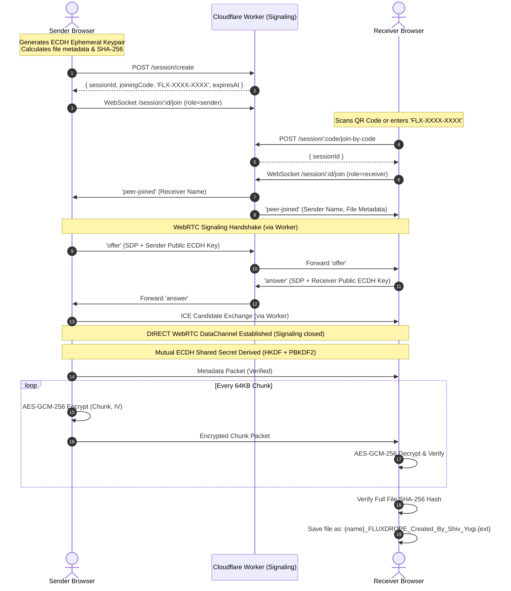

# FLUXDROPE ⚡

> **Premium Peer-to-Peer End-to-End Encrypted File Sharing**  
> *Architected & Created By Shiv Yogi*

[](LICENSE)
[]()
[]()
[]()
[]()

---

## 💎 Overview

**FLUXDROPE** is an ultra-secure, zero-knowledge, peer-to-peer file sharing platform designed for instantaneous transfers of any file size without third-party surveillance, cloud storage intermediaries, or bandwidth throttling.

All transfers travel directly between browsers via **WebRTC DataChannels**, authenticated using ephemeral **ECDH (Elliptic Curve Diffie-Hellman)** key agreements and encrypted chunk-by-chunk with authenticated **AES-GCM-256**. The lightweight Cloudflare Worker signaling backend handles handshake discovery through short-lived joining codes and automatically self-terminates sessions.

Transferred files automatically adhere to the signature naming convention:  
`{original_filename}_FLUXDROPE_Created_By_Shiv_Yogi.{ext}`

---

## ✨ Features

- 🔒 **Zero-Knowledge End-to-End Encryption**: Every 64 KB chunk is encrypted with AES-GCM-256 using an ephemeral key derived from ECDH P-256 key exchange and optional PBKDF2 password derivation.
- 🚀 **Direct Browser-to-Browser WebRTC**: Zero middleman servers. Files stream directly between peers at maximum local or internet connection throughput.
- 📱 **15 Exquisite QR Code Templates**: Liquid Glass, Neon Emerald, Cyber Grid, Aurora Glow, Crystal Glass, Obsidian Black, Holographic, Minimal Premium, Circular Frame, Geometric Frame, Frosted Glass, Metallic Silver, Deep Space, Aurora Violet, and Dynamic Spectrum.
- 🔑 **Cryptographic Password Protection**: Optional recipient password authorization combining HKDF, PBKDF2 (100,000 iterations), and constant-time verification tokens.
- ⚡ **Global Cloudflare Edge Signaling**: Low-latency WebSocket rendezvous managed via Cloudflare Workers and Durable Objects.
- 🎯 **Short-Lived Joining Codes**: Human-readable `FLX-XXXX-XXXX` codes with automatic 30-minute expiration.
- 🛡️ **SHA-256 Integrity Verification**: End-to-end cryptographic checksum calculation ensures file accuracy before saving to disk.
- 🌊 **Backpressure Flow Control**: High/Low threshold buffering prevents browser out-of-memory errors when transferring gigabyte files.
- 📲 **Progressive Web App (PWA)**: Standalone installation on desktop and mobile with native Web Share Target integration.

---

## 🏛️ Architecture & Flow



---

## 🔐 Cryptographic Security Model

FLUXDROPE provides multi-layered confidentiality, authenticity, and forward secrecy:

### 1. Ephemeral Key Exchange (ECDH P-256)
- Each peer generates a fresh, ephemeral **ECDH key pair** (`P-256` curve) using the Web Cryptography API (`crypto.subtle`).
- Ephemeral public keys are exchanged during the initial handshake.
- A raw 256-bit shared secret is derived using `crypto.subtle.deriveBits()`.

### 2. Password Hardening (PBKDF2 + HKDF)
- If password protection is enabled, a cryptographically secure 16-byte random salt is generated.
- A key-encryption key is derived using **PBKDF2** (`HMAC-SHA-256`, 100,000 iterations).
- The ECDH shared secret and PBKDF2 key are combined via **HKDF (RFC 5869)** to produce the final 256-bit symmetric session key:
  $$\text{Key} = \text{HKDF-Expand}(\text{PBKDF2}(\text{password}, \text{salt}), \text{ECDH Secret}, \text{"FLUXDROPE-v1"})$$

### 3. Authenticated Encryption (AES-GCM-256)
- Files are sliced into 64 KB binary chunks.
- Each chunk is encrypted with **AES-GCM** using a unique 96-bit initialization vector (IV) derived deterministically from the chunk index and a random session base IV.
- The 128-bit authentication tag guarantees that chunks cannot be modified or re-ordered in transit.

### 4. Integrity Checksum (SHA-256)
- The sender pre-computes a full SHA-256 checksum of the unencrypted file.
- The receiver computes a running SHA-256 hash as chunks are decrypted.
- If the computed hash fails to match the sender's manifest, the file is quarantined and rejected.

### 5. Threat Model & Boundaries
- **Signaling Zero-Knowledge**: The Cloudflare Worker signaling server and KV storage only see WebRTC session descriptors (SDP) and ICE network candidates. They **never** receive file contents or AES decryption keys.
- **TURN Relay Privacy**: If a direct P2P link cannot be established (e.g. restrictive symmetric NAT) and falls back to a TURN relay, the relay only passes encrypted ciphertext chunks. The relay operator cannot inspect file data.
- **Client Resource Isolation**: Chunking with stream backpressure prevents high-memory denial-of-service in browsers.

---

## 🚀 Quick Start (Local Development)

Because WebRTC and the Web Cryptography API require a secure context (`HTTPS` or `localhost`):

1. **Clone or navigate to the repository**:
   ```bash
   cd FLUXDROPE
   ```

2. **Serve with any local HTTPS or HTTP static server**:
   ```bash
   # Using Python 3:
   python3 -m http.server 8080

   # Or using Node.js npx serve:
   npx serve . -l 8080
   ```

3. Open your browser at `http://localhost:8080`.

---

## 🌐 Cloudflare Worker Deployment

To run your own private signaling backend:

1. **Install Wrangler**:
   ```bash
   npm install -g wrangler
   ```

2. **Login & provision KV namespace**:
   ```bash
   wrangler login
   cd cloudflare-worker
   wrangler kv:namespace create JOINING_CODES
   ```

3. **Update `wrangler.toml`**:
   Insert the KV namespace ID into `cloudflare-worker/wrangler.toml`.

4. **Deploy**:
   ```bash
   wrangler deploy
   ```

5. **Update Client**:
   Set `FLUXDROPE_SIGNALING_URL` in `js/app.js` to your deployed Worker URL:
   `https://fluxdrope-signaling.<your-subdomain>.workers.dev`

---

## 📦 GitHub Pages Deployment

FLUXDROPE is 100% static frontend friendly:

1. Push this repository to GitHub.
2. In your repository settings, navigate to **Settings > Pages**.
3. Under **Build and deployment > Source**, select **Deploy from a branch**.
4. Choose `main` (or `master`) and folder `/ (root)`.
5. Click **Save**. GitHub Pages will deploy FLUXDROPE with automatic HTTPS!

---

## ⚙️ STUN & TURN Configuration

FLUXDROPE connects over direct UDP whenever possible. If both peers are behind restrictive enterprise firewalls or symmetric NATs, a TURN server can be added to `js/webrtc-manager.js`:

```javascript
const rtcConfig = {
  iceServers: [
    { urls: 'stun:stun.l.google.com:19302' },
    { urls: 'stun:stun.cloudflare.com:3478' },
    // Optional TURN configuration:
    /*
    {
      urls: 'turn:turn.yourdomain.com:3478',
      username: 'fluxdrope_user',
      credential: 'secure_password'
    }
    */
  ]
};
```

---

## 🧪 Testing Guide

- **Cross-Device Testing**: Open FLUXDROPE on your computer, drag in a file, generate the QR code, and scan it with your smartphone's camera.
- **Password Verification**: Set a transfer password on the sender; verify that incorrect passwords on the receiver reject the transfer immediately.
- **Hash Integrity Test**: Send any large video, archive, or executable; observe that the SHA-256 verification completes and the file downloads with the signature postfix:
  `{filename}_FLUXDROPE_Created_By_Shiv_Yogi.{ext}`

---

## 📄 License

Distributed under the MIT License. See `LICENSE` for details.

**FLUXDROPE — Created By Shiv Yogi**
